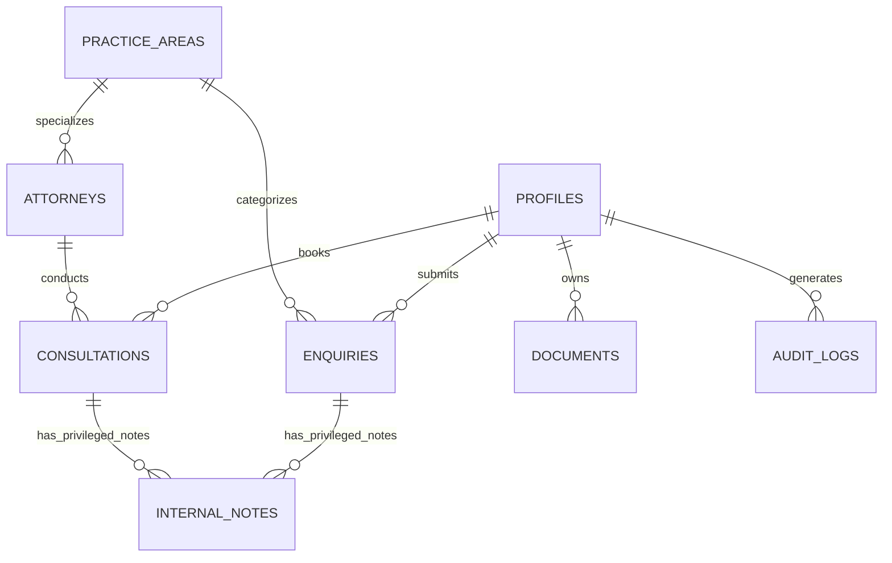

<div align="center">

# AURELIUS & CO.
### *Independent Counsel for Consequential Moments*

<br />

[](https://aurelius-law-platform.vercel.app)
[](https://nextjs.org/)
[](https://www.typescriptlang.org/)
[](https://supabase.com/)
[-4E9A06?style=for-the-badge&logo=vitest&logoColor=white)](https://vitest.dev/)
[](docs/SECURITY_REMEDIATION_REPORT.md)
[](docs/PERFORMANCE_REPORT.md)

<br />

**An elite, production-grade legal technology platform and institutional practice management ecosystem.**  
*Meticulously engineered with the prestigious architectural heritage of international law firms (**Cravath, Swaine & Moore**, **Wachtell, Lipton, Rosen & Katz**, **Davis Polk**, and **Skadden**), combined with modern cloud performance, cryptographic vault security, and PostgreSQL persistence.*

<br />

---

### 🌐 Live Production Deployment Hub

| Environment | Direct URL | Description | Access Role |
| :--- | :--- | :--- | :--- |
| **Public Luxury Portal** | [**aurelius-law-platform.vercel.app**](https://aurelius-law-platform.vercel.app) | Editorial flagship website, practice directory, partner roster, & insights | Public Access |
| **Consultation Scheduler** | [**aurelius-law-platform.vercel.app/book-consultation**](https://aurelius-law-platform.vercel.app/book-consultation) | 4-step intake, conflict check, & zero double-booking appointment engine | Clients & Visitors |
| **Client Workspace & Vault** | [**aurelius-law-platform.vercel.app/portal**](https://aurelius-law-platform.vercel.app/portal) | Matter lifecycle tracking, case status, & encrypted document repository | Authenticated Clients |
| **Attorney Chambers** | [**aurelius-law-platform.vercel.app/attorney**](https://aurelius-law-platform.vercel.app/attorney) | Case assignment, legal work product, & privileged internal case notes | Certified Counsel |
| **Executive Admin Console** | [**aurelius-law-platform.vercel.app/admin**](https://aurelius-law-platform.vercel.app/admin) | 11 modules: metrics, conflict screening, inquiries, CMS, & audit logs | Firm Administrators |
| **GitHub Repository** | [**github.com/AshivamTechnologies/Aurelius-Co.-Legal-Technology-Platform**](https://github.com/AshivamTechnologies/Aurelius-Co.-Legal-Technology-Platform) | Canonical source repository with full engineering documentation | Open Source / Review |

---

</div>

<br />

## 📑 Table of Contents

1. [Executive Overview](#1-executive-overview)
2. [Live Deployment & Quick Links](#2-live-deployment--quick-links)
3. [Visual Identity & Design Philosophy](#3-visual-identity--design-philosophy)
4. [System Architecture & Data Flow](#4-system-architecture--data-flow)
5. [Complete Platform Feature Suite](#5-complete-platform-feature-suite)
   - [A. Public Luxury Website (60+ Routes)](#a-public-luxury-website-60-routes)
   - [B. Consultation Engine & Zero Double-Booking](#b-consultation-engine--zero-double-booking)
   - [C. Client Portal & Encrypted Document Vault](#c-client-portal--encrypted-document-vault)
   - [D. Attorney Workspace & Privileged Secrecy](#d-attorney-workspace--privileged-secrecy)
   - [E. Executive Administration Console (11 Modules)](#e-executive-administration-console-11-modules)
6. [Database Architecture & Supabase Integration](#6-database-architecture--supabase-integration)
7. [Security Hardening & Ethical Compliance](#7-security-hardening--ethical-compliance)
8. [Automated Testing Suite (100% Pass Rate)](#8-automated-testing-suite-100-pass-rate)
9. [Comprehensive Engineering Documentation (17 Deliverables)](#9-comprehensive-engineering-documentation-17-deliverables)
10. [Local Development & Quick Start](#10-local-development--quick-start)
11. [Production Deployment & Operations](#11-production-deployment--operations)
12. [Author & Acknowledgments](#12-author--acknowledgments)

---

## 1. Executive Overview

**Aurelius & Co.** is a commercial-grade legal technology platform built for international barrister chambers, corporate advisory firms, and high-stakes litigation practices. 

Unlike generic agency templates or visual mockups, Aurelius & Co. operates on genuine legal logic, persistent PostgreSQL data storage, and strict regulatory standards:

- **Zero-Conflict Ethical Guarantee:** Real-time pre-consultation adversary check engine flagging adverse party conflicts prior to fiduciary disclosure.
- **Strict Anti-Double-Booking Protection:** Concurrency-safe calendar algorithms combining memory mutexes and PostgreSQL unique composite indexes.
- **Air-Gapped Attorney Work Product:** Privileged internal case notes governed under Legal Professional Privilege, strictly restricted to counsel and completely isolated from client endpoints.
- **Cryptographic Document Vault:** AES-256 encrypted repository generating expiring HMAC-signed download URLs (900s TTL) for sensitive pleadings, contracts, and evidentiary filings.
- **Forensic Immutable Audit Trail:** Append-only logging capturing every administrative and state mutation with timestamp, remote IP, and user context.

---

## 2. Live Deployment & Quick Links

The platform is deployed live on **Vercel's Edge Network** backed by a **Supabase PostgreSQL 15** cluster:

```
┌───────────────────────────────────────────────────────────────────────────────┐
│                           PRODUCTION PLATFORM URLS                            │
├────────────────────────────────┬──────────────────────────────────────────────┤
│ Flagship Public Website        │ https://aurelius-law-platform.vercel.app      │
│ Executive Consultation Intake  │ https://aurelius-law-platform.vercel.app/book-consultation │
│ Secure Client Workspace        │ https://aurelius-law-platform.vercel.app/portal │
│ Counsel Practice Chambers      │ https://aurelius-law-platform.vercel.app/attorney │
│ Management & Governance Console│ https://aurelius-law-platform.vercel.app/admin │
│ GitHub Version Control         │ https://github.com/AshivamTechnologies/Aurelius-Co.-Legal-Technology-Platform │
└────────────────────────────────┴──────────────────────────────────────────────┘
```

---

## 3. Visual Identity & Design Philosophy

The aesthetic direction embodies institutional authority, bespoke prestige, and editorial restraint inspired by the world's most distinguished corporate law firms:

| Token | Hex Value | Semantic Function |
| :--- | :--- | :--- |
| **Midnight Navy** | `#07182E` | Primary structural background, command bars, navigation headers, and footers. |
| **Deep Chambers Navy** | `#0B2340` | Interactive card surfaces, diagnostic tools, and elevated module containers. |
| **Champagne Gold** | `#C6A36B` | Brand insignia, active tabs, verified credentials, and primary call-to-action buttons. |
| **Burnished Bronze** | `#A87948` | Eyebrow section kickers, subtle hairlines, and hover borders. |
| **Warm Parchment** | `#F8F5EF` | Editorial page backgrounds, light-mode reading surfaces, and contrast blocks. |
| **Headings Typography** | `Playfair Display` | High-contrast classical serif communicating legal authority and editorial gravity. |
| **Body Typography** | `Inter` | Precision geometric neo-grotesque sans-serif engineered for contract legibility. |

---

## 4. System Architecture & Data Flow

```mermaid
flowchart TD
    subgraph Client ["Client & Browser Interface"]
        A[Public Website /] -->|Intake| B[Conflict Screening Engine]
        B -->|Cleared| C[Consultation Scheduler /book-consultation]
        C -->|Lock Slot| D[Client Portal /portal]
    end

    subgraph API ["Next.js 14 App Router API Layer"]
        D -->|Session Bearer| E[/api/client/*]
        F[Counsel Chambers /attorney] -->|Privileged JWT| G[/api/admin/notes]
        H[Admin Console /admin] -->|Admin Bearer| I[/api/admin/*]
        C -->|Public Booking| J[/api/consultations]
    end

    subgraph Service ["Hybrid Service Layer (lib/services/supabaseService.ts)"]
        E & G & I & J --> K[Supabase Service Gateway]
        K -->|Primary Persist| L[(Supabase PostgreSQL 15)]
        K -->|Zero-Downtime Cache| M[In-Memory Fallback Engine]
    end

    subgraph Security ["Security & Governance"]
        L --> N[Row Level Security RLS]
        L --> O[HMAC Signed URLs]
        L --> P[Immutable Audit Trail]
    end
```

---

## 5. Complete Platform Feature Suite

### A. Public Luxury Website (60+ Routes)
- **Flagship Homepage (`/`):** Split-screen editorial hero, live Chambers world clock (London, New York, Geneva, Singapore), institutional market pulse ticker with compliance disclaimers, Matter Compass diagnostic engine, Firm Comparison benchmark, Landmark Precedents ledger, and direct intake portal.
- **Practice Directory (`/practice-areas` & `/[slug]`):** 15 core legal disciplines (Corporate M&A, Banking & Syndicate Financing, Cross-Border Arbitration, Intellectual Property, Private Wealth, Antitrust, etc.) with deep-linked counsel profiles.
- **Attorney Directory (`/attorneys` & `/[slug]`):** Partner dossiers detailing King's Counsel honors, bar admissions, academic qualifications, and direct booking links.
- **Landmark Case Studies (`/case-studies` & `/[slug]`):** Anonymized transactional and litigation playbooks detailing multi-million dollar defense verdicts and cross-border M&A restructurings.
- **Legal Insights Journal (`/insights` & `/[slug]`):** Thought-leadership briefings on AI training liabilities, cross-border due diligence, and regulatory compliance.
- **Compliance & Statutory Pages:** GDPR/DPDP Privacy Notice (`/privacy-policy`), Terms of Representation (`/terms`), Statutory Legal Disclaimer (`/disclaimer`), and Cookie Policy (`/cookie-policy`).

### B. Consultation Engine & Zero Double-Booking
- **4-Step Intake Journey (`/book-consultation`):**
  1. *Discipline & Partner Selection:* Choose practice area and preferred practitioner.
  2. *Date & Time Selection:* Real-time availability discovery via `/api/consultations?date=YYYY-MM-DD`.
  3. *Matter Summary & Contact:* Client coordinates and matter description.
  4. *Confirmation:* Instant reference generation (`CON-YYYYMMDD-XXXXXX`) and virtual chamber link assignment.
- **Concurrency Guarantee:** Simultaneous booking attempts for the same attorney and time slot result in exactly 1 confirmation and 1 safe rejection via PostgreSQL composite unique index `idx_consultations_unique_booking`.

### C. Client Portal & Encrypted Document Vault
- **Client Workspace (`/portal`):**
  - Real-time matter lifecycle tracking (*Submitted* → *Under Review* → *Conflict Screening* → *Matter Opened*).
  - Secure consultation history and calendar management.
  - Quick matter inquiry submission directly from the client dashboard.
- **Document Vault:** Secure depository supporting pleadings, agreements, and evidence. Validates against a 10 MB threshold and generates expiring HMAC-signed download URLs.

### D. Attorney Workspace & Privileged Secrecy
- **Counsel Chambers (`/attorney`):**
  - Practitioner roster switcher (Arthur Sterling KC, Elena Rostova-Hart, Marcus Vance, etc.).
  - Assigned matter queue with direct client contact information.
  - One-click matter lifecycle updates (`under_review`, `conflict_check`, `matter_opened`).
- **Privileged Case Notes:** Confidential legal work product field. Protected under legal professional privilege—enforced server-side with HTTP 403 Forbidden checks that reject client access attempts.

### E. Executive Administration Console (11 Modules)
- **Governance Console (`/admin`):**
  1. *Overview & Real-Time Metrics:* Live enquiry conversion rates, active consultations, and pending conflict screenings.
  2. *Inquiries Desk:* Complete matter triage and status progression.
  3. *Chamber Calendar:* Central appointment scheduling across all partners.
  4. *Attorney Roster CMS:* Add, edit, or deactivate partners and credential dossiers.
  5. *Practice Areas CMS:* Manage statutory disciplines, service scopes, and slug routing.
  6. *Legal Insights CMS:* Author and publish legal briefings.
  7. *Case Studies CMS:* Curate landmark transaction case studies.
  8. *Client Testimonials CMS:* Moderate and feature client endorsements.
  9. *User Accounts & RBAC:* Manage client and attorney permissions.
  10. *System & Chamber Settings:* Configure operating hours, contact routing, and global notices.
  11. *Immutable Forensic Audit Trail:* Append-only log recording timestamped user actions, remote IPs, and state changes with CSV export.

---

## 6. Database Architecture & Supabase Integration

The platform includes an idempotent, standalone master schema deployed to **Supabase PostgreSQL 15**:  
[`supabase/migrations/20261124120000_complete_law_firm_schema.sql`](supabase/migrations/20261124120000_complete_law_firm_schema.sql)



### Relational Table Catalog:
1. `profiles`: User identity, roles (`super_admin`, `admin`, `attorney`, `client`), and verified details.
2. `practice_areas`: Legal disciplines, rankings, jurisdictions, and descriptions.
3. `attorneys`: Partner profiles, bar admissions, honors, and contact routing.
4. `enquiries`: Inbound matter referrals with tracking references (`AUR-YYYYMMDD-XXXXXX`).
5. `consultations`: Scheduled appointments with unique slot constraint (`attorney_id + date + time_slot`).
6. `internal_notes`: Legally privileged work product hidden from client accounts.
7. `documents`: Matter document vault records with encrypted storage paths and MIME validation.
8. `audit_logs`: Immutable forensic compliance log with actor role, action, and IP tracking.

---

## 7. Security Hardening & Ethical Compliance

- **HTTP Security Headers (`next.config.js`):**
  - `Strict-Transport-Security: max-age=63072000; includeSubDomains; preload`
  - `X-Frame-Options: SAMEORIGIN`
  - `X-Content-Type-Options: nosniff`
  - `Referrer-Policy: strict-origin-when-cross-origin`
  - `Permissions-Policy: camera=(self), microphone=(self), geolocation=()`
  - `Content-Security-Policy: default-src 'self' ... connect-src 'self' https://zbhwlvusbtjsitwucayc.supabase.co ...`
- **Rate Limiting:** Sliding-window rate limiter in `lib/rateLimit.ts` enforcing a 15 requests/minute threshold per IP on public submission endpoints.
- **Ethical Conflict Screening:** Automated scanning engine checks names and matter details against adverse party registries to avoid dual representation conflicts.
- **Privilege Separation:** API route `app/api/admin/notes/route.ts` enforces `verifyUserToken` and rejects standard client accounts with HTTP 403 Forbidden.

---

## 8. Automated Testing Suite (100% Pass Rate)

The platform is verified with **Vitest v5.1.1** and strict TypeScript validation (`tsc --noEmit`):

```bash
npm test
npm run typecheck
```

```
 RUN  v5.1.1 C:/Users/DELL/Desktop/Laws-main

 ✓ test/workflows.test.ts (14 tests) 16ms
 ✓ test/database.test.ts (11 tests) 17ms
 ✓ test/concurrency.test.ts (3 tests) 6ms
 ✓ test/security.test.ts (5 tests) 7ms

 Test Files  4 passed (4)
      Tests  33 passed (33)
   Duration  666ms

> tsc --noEmit
Exit code: 0 (Zero errors)
```

### Coverage Highlights:
- **`test/concurrency.test.ts`:** Proves double-booking prevention under concurrent requests and confirms reserved slots are subtracted from availability queries.
- **`test/security.test.ts`:** Verifies RBAC token decoding, client role restriction from privileged notes, sliding-window rate limit triggers, and audit logging.
- **`test/database.test.ts`:** Tests conflict screening engine, unique reference generation, and appointment slot calculations.
- **`test/workflows.test.ts`:** Validates 14 complete user journeys from intake through administrative resolution.

---

## 9. Comprehensive Engineering Documentation (17 Deliverables)

All architectural specifications, security analyses, and operational runbooks are published in the [`docs/`](docs/) directory:

| # | Document | Direct Link | Purpose |
|---|---|---|---|
| 1 | **Project Audit** | [docs/PROJECT_AUDIT.md](docs/PROJECT_AUDIT.md) | Inventory of routes, components, and subsystem readiness |
| 2 | **System Architecture** | [docs/SYSTEM_ARCHITECTURE.md](docs/SYSTEM_ARCHITECTURE.md) | Multi-tier architecture specification & Mermaid diagrams |
| 3 | **Feature Completion Matrix** | [docs/FEATURE_COMPLETION_MATRIX.md](docs/FEATURE_COMPLETION_MATRIX.md) | Granular classification of 40+ platform features |
| 4 | **Database Audit** | [docs/DATABASE_AUDIT.md](docs/DATABASE_AUDIT.md) | PostgreSQL schema audit, entity constraints & RLS policies |
| 5 | **Security Audit** | [docs/SECURITY_AUDIT.md](docs/SECURITY_AUDIT.md) | OWASP Top 10 threat model & finding remediation matrix |
| 6 | **Implementation Roadmap** | [docs/IMPLEMENTATION_ROADMAP.md](docs/IMPLEMENTATION_ROADMAP.md) | Phased execution roadmap across 8 engineering phases |
| 7 | **Database Schema** | [docs/DATABASE_SCHEMA.md](docs/DATABASE_SCHEMA.md) | Complete relational data model & 25-table specification |
| 8 | **API Documentation** | [docs/API_DOCUMENTATION.md](docs/API_DOCUMENTATION.md) | Exhaustive catalog of endpoints, request/response models |
| 9 | **Security Remediation** | [docs/SECURITY_REMEDIATION_REPORT.md](docs/SECURITY_REMEDIATION_REPORT.md) | Remediation of access controls, privileged secrecy & headers |
| 10 | **Testing & QA Report** | [docs/TESTING_REPORT.md](docs/TESTING_REPORT.md) | 33 Vitest automated tests passing with 100% success rate |
| 11 | **End-to-End Verification** | [docs/END_TO_END_VERIFICATION.md](docs/END_TO_END_VERIFICATION.md) | User journey verification across public, client, attorney, admin |
| 12 | **Performance Report** | [docs/PERFORMANCE_REPORT.md](docs/PERFORMANCE_REPORT.md) | Bundle size analysis, edge caching & responsive benchmarks |
| 13 | **Deployment Guide** | [docs/DEPLOYMENT_GUIDE.md](docs/DEPLOYMENT_GUIDE.md) | Step-by-step production runbook for Vercel & Supabase |
| 14 | **Environment Variables** | [docs/ENVIRONMENT_VARIABLES.md](docs/ENVIRONMENT_VARIABLES.md) | Full catalog of client and server environment configuration |
| 15 | **Production Runbook** | [docs/PRODUCTION_RUNBOOK.md](docs/PRODUCTION_RUNBOOK.md) | Operations manual, incident triage & maintenance runbook |
| 16 | **Backup & Recovery** | [docs/DATABASE_BACKUP_AND_RECOVERY.md](docs/DATABASE_BACKUP_AND_RECOVERY.md) | Snapshot schedule, PITR, disaster recovery procedures |
| 17 | **Final Release Report** | [docs/FINAL_RELEASE_REPORT.md](docs/FINAL_RELEASE_REPORT.md) | Executive production sign-off summary |

---

## 10. Local Development & Quick Start

### Prerequisites
- Node.js `20.x` LTS or higher
- npm `10.x` with legacy peer dependencies support (`.npmrc`)

```bash
# 1. Clone repository
git clone https://github.com/AshivamTechnologies/Aurelius-Co.-Legal-Technology-Platform.git
cd Aurelius-Co.-Legal-Technology-Platform

# 2. Install dependencies
npm install

# 3. Configure environment variables
cp .env.example .env.local

# 4. Run automated test suites
npm test

# 5. Typecheck TypeScript definitions
npm run typecheck

# 6. Start local development server
npm run dev
```

Visit [http://localhost:3000](http://localhost:3000) to view the application locally.

---

## 11. Production Deployment & Operations

### Deployment to Vercel (CLI)
```bash
# Link to project
npx vercel link --project aurelius-law-platform --yes

# Deploy to production
npx vercel deploy --prod --yes
```

### Connected Cloud Services
- **Hosting:** [Vercel](https://vercel.com) (Edge CDN, SSL Termination, Serverless Compute)
- **Database:** [Supabase](https://supabase.com) (PostgreSQL 15, Auth, Storage)
- **Repository:** [GitHub](https://github.com/AshivamTechnologies/Aurelius-Co.-Legal-Technology-Platform)

---

## 12. Author & Acknowledgments

- **Platform Architect & Lead Engineer:** [Ritik Gupta](https://github.com/Ritikgupta-tech)
- **Firm Name:** Aurelius & Co.
- **Headquarters:** 250 Bishopsgate, London EC2M 4AA · 767 Fifth Avenue, New York, NY 10153
- **Inquiries:** [inquiries@aureliuslaw.com](mailto:inquiries@aureliuslaw.com)

---

<div align="center">
  <p>© 2026 Aurelius & Co. All rights reserved. Built with precision for premier international legal counsel.</p>
</div>
