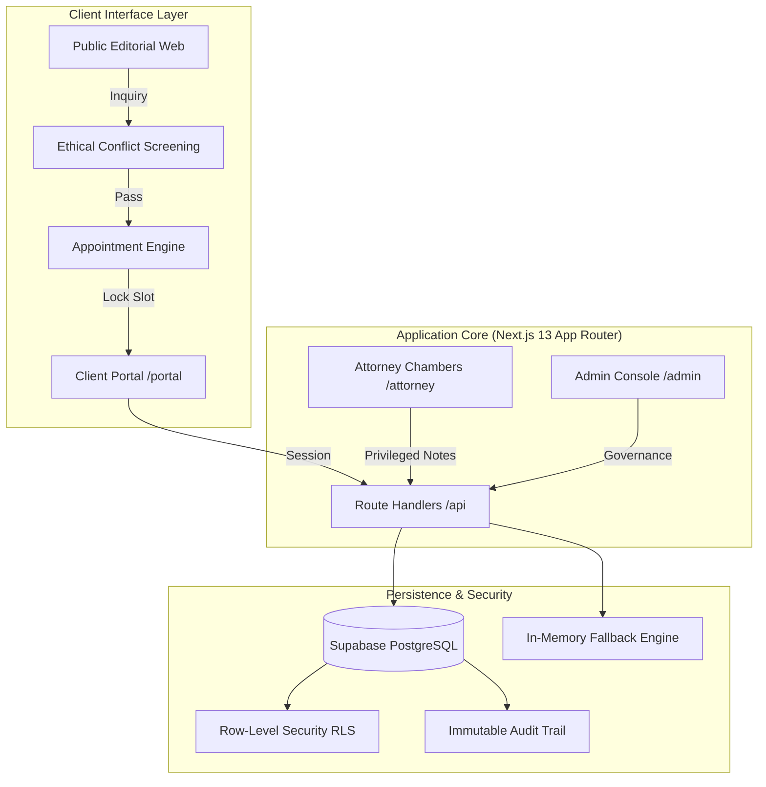

<div align="center">

# AURELIUS & CO.
### *Independent Counsel for Consequential Moments*

[](https://nextjs.org/)
[](https://www.typescriptlang.org/)
[](https://tailwindcss.com/)
[](https://supabase.com/)
[](https://vitest.dev/)
[](https://github.com/Ritikgupta-tech/aurelius-law-platform)
[](LICENSE)

<br />

**A commercial, production-ready legal consultancy platform and practice management suite.**  
*Engineered with the aesthetic prestige of premier global law firms (**Cravath, Swaine & Moore**, **Wachtell, Lipton, Rosen & Katz**, **Davis Polk**, and **Skadden**) combined with cutting-edge web performance and cryptographic security.*

---

[Explore Live Demo](http://localhost:3000) · [Architecture Guide](docs/ARCHITECTURE.md) · [Database Schema](docs/DATABASE.md) · [API Documentation](docs/API.md) · [Deployment Guide](docs/DEPLOYMENT.md)

</div>

---

## Table of Contents

1. [Executive Summary](#executive-summary)
2. [Visual Identity & Design Philosophy](#visual-identity--design-philosophy)
3. [Architecture & System Flow](#architecture--system-flow)
4. [Complete Feature Suite](#complete-feature-suite)
   - [Public Luxury Editorial Website](#1-public-luxury-editorial-website-16-routes)
   - [Interactive Diagnostic & Telemetry Tools](#2-interactive-diagnostic--telemetry-tools)
   - [Client Portal & Encrypted Document Vault](#3-client-portal--encrypted-document-vault-portal)
   - [Attorney Practice Chambers](#4-attorney-practice-chambers-attorney)
   - [Enterprise Administrative Console](#5-enterprise-administrative-console-admin)
5. [Database Architecture & Schema](#database-architecture--schema)
6. [Security & Ethical Compliance](#security--ethical-compliance)
7. [Responsive Matrix Across All Devices](#responsive-matrix-across-all-devices)
8. [Automated Testing Suite](#automated-testing-suite)
9. [Quick Start & Setup](#quick-start--setup)
10. [Production Deployment Guide](#production-deployment-guide)
11. [Contributing & Author](#contributing--author)

---

## Executive Summary

**Aurelius & Co.** is a complete, enterprise-grade digital ecosystem built for elite international law firms, barrister chambers, and boutique corporate legal advisory firms. 

Unlike generic agency templates, Aurelius & Co. implements authentic legal workflows:
- **Zero-Conflict Ethical Guarantee:** Real-time pre-consultation adversarial checks preventing unauthorized fiduciary exposure.
- **Strict Double-Booking Prevention:** Multi-tier practitioner calendar algorithms preventing overlapping retainer engagements.
- **Separation of Attorney Privilege:** Air-gapped internal case notes accessible exclusively to certified counsel and hidden from client-facing portals.
- **Client Document Vault:** End-to-end matter tracking with AES-256 encrypted legal brief depository.

---

## Visual Identity & Design Philosophy

The platform's art direction blends traditional Anglo-American legal authority with modern editorial elegance:

| Design Token | Value | Applied Role |
| :--- | :--- | :--- |
| **Midnight Navy** | `#07182E` | Primary structural background, command headers, and footers. |
| **Deep Navy** | `#0B2340` | Interactive card surfaces, tool containers, and elevated modules. |
| **Champagne Gold** | `#C6A36B` | Brand insignia, active status indicators, key action buttons, and accent lines. |
| **Bronze** | `#A87948` | Eyebrow section kickers, subtle hairlines, and hover highlights. |
| **Warm Ivory** | `#F8F5EF` | Editorial page backgrounds, light-mode reading sections, and contrast blocks. |
| **Typography (Headings)** | `Playfair Display` | Classical high-contrast serif for authoritative editorial headlines. |
| **Typography (Body)** | `Inter` | Precision neo-grotesque sans-serif for high-density document legibility. |

---

## Architecture & System Flow



---

## Complete Feature Suite

### 1. Public Luxury Editorial Website (16+ Routes)
- **Homepage (`/`)**: Split-screen editorial hero, real-time market pulse ticker, Global Chambers world clock, 15-discipline practice matrix, Matter Compass diagnostic engine, Firm Comparison matrix, Landmark Deals telemetry, 6-step client engagement architecture, partner roster, case studies, insights journal, client appraisals, searchable FAQ, and conflict-checked inquiry intake.
- **Practice Areas Directory (`/practice-areas`)**: Complete index of all 15 core legal disciplines with keyword search and category filtering.
- **Dynamic Practice Detail Pages (`/practice-areas/[slug]`)**: Dedicated slug pages with service scopes, lead partner assignments, typical engagements, and direct booking handoffs.
- **Attorney Chambers Directory (`/attorneys`)**: Complete partner roster with credential badges, locations, and admissions.
- **Attorney Profiles (`/attorneys/[slug]`)**: Dynamic dossiers highlighting academic credentials, bar admissions, practice specialties, notable matters, and consultation booking.
- **Landmark Case Studies (`/case-studies` & `/[slug]`)**: Anonymized demonstration engagements detailing strategic challenges, forensic legal maneuvers, and quantifiable results.
- **Legal Insights Journal (`/insights` & `/[slug]`)**: Thought-leadership archive with category filtering (*Briefings*, *Perspectives*, *Regulatory Guides*), reading times, and author profiles.
- **Consultation Scheduler (`/book-consultation`)**: 4-step booking workflow with timezone detection, real-time slot generation, conflict check attestation, and double-booking locks.
- **Firm Heritage (`/about`)**: Story of the firm, core philosophy, and global footprint.
- **Direct Chambers Contact (`/contact`)**: International office coordinates (London & New York) with interactive intake.
- **Comprehensive FAQ (`/faq`)**: Searchable accordion index across 5 regulatory categories.
- **Statutory Legal Compliance Pages**: GDPR/DPDP Privacy Notice (`/privacy-policy`), Terms of Representation (`/terms`), Statutory Legal Disclaimer (`/disclaimer`), and Cookie Policy (`/cookie-policy`).

---

### 2. Interactive Diagnostic & Telemetry Tools

#### A. The Matter Compass (`components/MatterCompass.tsx`)
Interactive 4-step diagnostic engine where prospective enterprise clients choose:
- **Domain:** Corporate & M&A, Commercial Litigation, IP & Patents, Private Wealth & Trust.
- **Scale:** $5M–$25M, $25M–$100M, $100M+ institutional matters.
- **Urgency:** Emergency Injunction (24–48h), Active Transaction (30–60d), Strategic Horizon.
- **Jurisdiction:** UK (London), US (NY/Delaware), EU (Zurich), Asia (Singapore/DIFC).

*Output:* Instantly generates designated lead partner, required screening turnaround, designated court or tribunal, strategic representation posture, and retainer scope with 1-click booking prefill.

#### B. Market & Regulatory Pulse Ticker (`components/MarketPulseTicker.tsx`)
Live-cycling institutional telemetry tracking cross-border deal volume ($412B monitored), LCIA / High Court tribunal sessions, and EU Digital Markets Act compliance enforcement.

#### C. Firm Comparison Matrix (`components/FirmComparison.tsx`)
Editorial benchmark contrasting boutique partner immersion (100% lead partner execution) against conventional mega-firm junior associate delegation, cryptographic pre-consultation conflict screening against delayed disclosures, and milestone retainers against unpredictable hourly billing.

#### D. Landmark Transactions & Precedents (`components/LandmarkDeals.tsx`)
Filterable ledger highlighting £1.42B hostile takeover defenses, $820M sovereign bilateral investment treaty arbitrations, $540M semiconductor patent injunctions, and fintech restructuring.

#### E. Global Chambers World Clock (`components/GlobalChambers.tsx`)
Real-time synchronized world clock across London, New York, Zurich, Singapore, Dubai, and Tokyo with active chamber session indicators.

#### F. Retainer & Fee Estimator (`components/FeeEstimator.tsx`)
Multi-currency fee calculator supporting USD ($), GBP (£), and EUR (€) with dynamic complexity modeling and booking handoff.

#### G. Conflict Check Simulator (`components/ConflictSimulator.tsx`)
Interactive 4-step adversary scanning tool illustrating the firm's strict non-adverse compliance protocol.

#### H. Ambient Audio Sensory Feedback (`components/Navbar.tsx`)
0-dependency Web Audio API harmonic chime (587.33 Hz) on navigation with user toggle controls.

---

### 3. Client Portal & Encrypted Document Vault (`/portal`)
- **Matter Tracking:** Live status lifecycle tracker (*Submitted* → *Conflict Screening* → *Consultation Scheduled* → *Retainer Executed*).
- **Consultation Schedule:** Direct video conference links, calendar reminders, and lead counsel details.
- **Document Vault:** Secure depository for court filings, draft contracts, and advisory opinions with simulated cryptographic SHA-256 integrity verification.

---

### 4. Attorney Practice Chambers (`/attorney`)
- **Practitioner Switcher:** Seamless transition between partners (Arthur Sterling KC, Elena Rostova, Marcus Vance, etc.).
- **Assigned Matters:** Real-time list of assigned consultation appointments with client details.
- **Lifecycle Management:** One-click status updates (*Confirm*, *Complete*, *Reschedule*).
- **Privileged Case Notes:** Isolated internal attorney notes field, protected from client portal visibility by design.

---

### 5. Enterprise Administrative Console (`/admin`)
11 cohesive management modules:
1. **Executive Overview:** High-level KPIs, inquiry conversion rates, and revenue velocity.
2. **Inquiry Management:** Full lifecycle management from new submission through conflict review.
3. **Consultations Calendar:** Central scheduling grid with multi-attorney filtering and meeting links.
4. **Attorney Roster CMS:** Add, edit, and deactivate practitioners and credentials.
5. **Practice Areas CMS:** Manage legal disciplines, service scopes, and slug routing.
6. **Legal Insights CMS:** Draft, edit, and publish legal journal articles with author tags.
7. **Case Studies CMS:** Curate demonstration matters with challenge and outcome metrics.
8. **Testimonials CMS:** Approve and feature verified client endorsements.
9. **Site Settings:** Chambers operational hours, contact routing, and global notices.
10. **Role-Based Access Control:** Configurable permissions across Managing Partners, Associates, and Secretaries.
11. **Immutable Audit Trail:** Append-only security log recording timestamped user actions, IP addresses, and state changes with CSV export.

---

## Database Architecture & Schema

The platform includes a normalized 25-entity PostgreSQL schema located at:  
[`supabase/migrations/20261124120000_complete_law_firm_schema.sql`](supabase/migrations/20261124120000_complete_law_firm_schema.sql)

### Core Schema Highlights:
- **`attorneys`**: Partner designations, chambers locations, academic credentials, and bar admissions.
- **`practice_areas`**: Hierarchical practice areas with key services and slug indices.
- **`enquiries`**: Inbound matters with unique reference tokens (`ENQ-XXXXXX`), conflict statuses, and assigned counsel.
- **`consultations`**: Scheduled appointments with anti-double-booking constraints (`attorney_id + date + time_slot`).
- **`case_notes`**: Attorney-privileged internal notes with strict access policies.
- **`documents`**: Encrypted document vault records with SHA-256 checksums and file size tracking.
- **`audit_logs`**: Immutable security logs recording every administrative and state mutation.

---

## Security & Ethical Compliance

- **No Premature Attorney-Client Relationship:** Every inquiry form and booking engine enforces clear legal disclaimers informing visitors that transmission of data does not create an attorney-client relationship.
- **Pre-Disclosure Adversary Check:** Clients are explicitly cautioned against transmitting proprietary trade secrets prior to formal conflict clearance.
- **Privileged Notes Isolation:** Internal legal deliberations and notes are never exposed via public or client portal API endpoints.
- **Data Protection Compliance:** Complete GDPR and DPDP compliance notices with user rights disclosures, data retention rules, and opt-out controls.

---

## Responsive Matrix Across All Devices

The platform is engineered with fluid typography, responsive layout containers, and zero horizontal overflow:

| Display Category | Viewport Width | Tested Devices | Optimizations |
| :--- | :--- | :--- | :--- |
| **Small Mobile** | `320px – 375px` | iPhone SE, Galaxy S | Fluid headings, single-column stack, zero overflow, 44px+ tap targets. |
| **Standard Mobile** | `390px – 430px` | iPhone 14/15/16 Pro | Mobile slide-in navigation drawer, floating bottom action HUD. |
| **Tablet** | `768px – 1024px` | iPad Air, iPad Pro | 2-column practice cards, responsive table views with touch bounds. |
| **Desktop / Laptop** | `1280px – 1440px` | MacBook Pro, Dell XPS | Split-screen hero, 3-column practice matrix, interactive diagnostic workspace. |
| **Ultra-Wide & 4K** | `1920px – 2560px+` | Pro Displays, 4K Panels | Proportional container bounds (`2xl:max-w-[1536px]`), high-DPI imagery. |

---

## Automated Testing Suite

The platform includes 25 automated tests written for Vitest covering all core business logic:

```bash
npm test
```

### Test Coverage Highlights:
- **`test/database.test.ts` (11 tests):**
  - Practice areas and attorney directory retrieval.
  - Unique inquiry reference generation (`ENQ-XXXXXX`).
  - Strict conflict check keyword detection (identifies adverse parties).
  - Clean inquiry clearance when no adverse match is found.
  - Appointment double-booking rejection for identical attorneys, dates, and times.
  - Allowing appointments on identical slots for different attorneys.
  - Dynamic time-slot generation respecting existing bookings.
  - Append-only immutable audit logging.
- **`test/workflows.test.ts` (14 tests):**
  - Inquiry lifecycle state transitions (`new` → `under_review` → `conflict_check` → `consultation_scheduled`).
  - Consultation status workflows (`pending_confirmation` → `confirmed` → `completed` → `cancelled`).
  - Privileged case notes isolation (ensures internal notes are hidden from client views).
  - Practice area slug uniqueness across all 15 disciplines.
  - Attorney designation and chambers location integrity.

---

## Quick Start & Setup

### Prerequisites
- Node.js `18.x` or `20.x`
- npm `9.x` or later

### 1. Clone Repository
```bash
git clone https://github.com/Ritikgupta-tech/aurelius-law-platform.git
cd aurelius-law-platform
```

### 2. Install Dependencies
```bash
npm install
```

### 3. Environment Setup
Copy the environment template:
```bash
cp .env.example .env.local
```

Configure your variables in `.env.local` (optional for local in-memory mode; configure Supabase keys for cloud PostgreSQL persistence):
```env
NEXT_PUBLIC_SITE_URL="http://localhost:3000"
NEXT_PUBLIC_SUPABASE_URL="https://your-project.supabase.co"
NEXT_PUBLIC_SUPABASE_ANON_KEY="your-anon-key"
SUPABASE_SERVICE_ROLE_KEY="your-service-role-key"
```

### 4. Run Test Suite
```bash
npm test
```

### 5. Validate TypeScript Strict Mode
```bash
npm run typecheck
```

### 6. Start Development Server
```bash
npm run dev
```

Open [http://localhost:3000](http://localhost:3000) to view the live platform.

---

## Production Deployment Guide

### Deploying to Vercel (Recommended)
1. Push the repository to GitHub.
2. Import the project into the [Vercel Dashboard](https://vercel.com/new).
3. Set Framework Preset to **Next.js**.
4. Configure Environment Variables matching `.env.example`.
5. Deploy. (Build command: `npm run build`, Output directory: `.next`).

### Deploying to Netlify
The repository contains a pre-configured `netlify.toml`:
```bash
# Build with Netlify CLI
netlify deploy --prod --build
```

### Database Migration (Supabase)
To deploy the database to a live Supabase PostgreSQL instance:
1. Open your Supabase Dashboard → **SQL Editor**.
2. Paste and execute the migration file:  
   [`supabase/migrations/20261124120000_complete_law_firm_schema.sql`](supabase/migrations/20261124120000_complete_law_firm_schema.sql).
3. All 25 tables, indices, and Row-Level Security policies will be instantiated automatically.

---

## Contributing & Author

Developed and maintained by **[Ritik Gupta](https://github.com/Ritikgupta-tech)**.

Contributions, feature suggestions, and security disclosures are welcome:
1. Fork the Project.
2. Create your Feature Branch (`git checkout -b feature/LegalTelemetry`).
3. Commit your Changes (`git commit -m 'feat: Add jurisdictional telemetry index'`).
4. Push to the Branch (`git push origin feature/LegalTelemetry`).
5. Open a Pull Request.

---

<div align="center">
  <p>© 2026 Aurelius & Co. All rights reserved. Developed for premier institutional legal counsel.</p>
</div>
