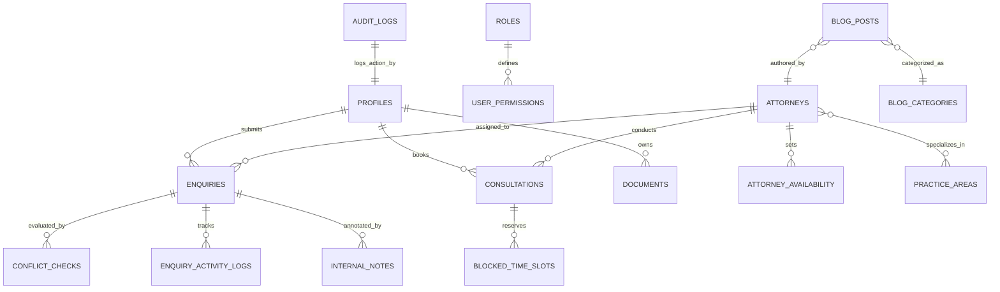

# Database Architecture & Entity-Relationship Model

## Schema Overview

The database is normalized across 25 distinct legal entities designed to uphold auditability, multi-jurisdiction data privacy, and ethical conflict separation.

### Entity Relationship Diagram (Mermaid)

## Entity Dictionary (25 Entities)

1. **`roles`**: System roles (`super_admin`, `admin`, `attorney`, `staff`, `client`).
2. **`user_permissions`**: Granular capability keys attached to roles.
3. **`profiles`**: User account credentials, names, phone numbers, and active role.
4. **`attorneys`**: Licensed practitioners with bar admissions, education, bios, photos, and active status.
5. **`practice_areas`**: 15 legal practice areas with short/full descriptions, lead attorneys, and key services.
6. **`attorney_practice_areas`**: Many-to-many relationship linking attorneys to practice groups.
7. **`enquiries`**: Inbound matter inquiries with reference (`AUR-YYYYMMDD-XXXXXX`), conflict status, and lifecycle stage.
8. **`enquiry_assignments`**: Formal assignment logs associating enquiries with attorneys.
9. **`enquiry_activity_logs`**: Chronological log of status transitions and contact attempts.
10. **`conflict_checks`**: Formal screening records documenting adverse parties checked and clearance outcome.
11. **`consultations`**: Scheduled appointments with reference (`CON-YYYYMMDD-XXXXXX`), time slot, timezone, and meeting links.
12. **`attorney_availability`**: Weekly recurring availability matrices per practitioner.
13. **`blocked_time_slots`**: Date-specific unavailable intervals preventing booking collisions.
14. **`clients`**: Corporate entity designations, registration numbers, and billing coordinates.
15. **`documents`**: Vault file metadata, storage paths, MIME types, and categories.
16. **`document_access_logs`**: Read and download tracking for audit compliance.
17. **`internal_notes`**: Privileged lawyer-to-lawyer observations completely hidden from clients.
18. **`notifications`**: System notifications delivered to client or attorney inboxes.
19. **`blog_posts`**: Editorial articles and regulatory briefings with author references.
20. **`blog_categories`**: Content classifications (`Briefing`, `Perspective`, `Guide`).
21. **`case_studies`**: Demonstration matter histories with challenge, strategy, and outcome.
22. **`testimonials`**: Verified client quotes with approval moderation flags.
23. **`faqs`**: Frequently asked questions across 5 practice categories.
24. **`site_settings`**: Global firm phone numbers, chamber addresses, and disclaimers.
25. **`audit_logs`**: Immutable security audit trail recording all administrative updates.

## Indexes & Performance Tuning

- Composite index on `(scheduled_date, time_slot, status)` on `consultations` for sub-millisecond slot queries.
- Lowercase index on `lower(email)` on `enquiries` for rapid conflict check matching.
- Unique slug indexes on `attorneys`, `practice_areas`, `blog_posts`, and `case_studies`.
