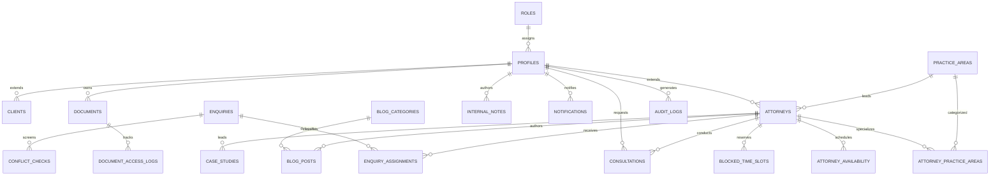

# AURELIUS & CO. — DATABASE SCHEMA & AUDIT REPORT
**Database Host:** Supabase Managed PostgreSQL 15  
**Project ID:** `zbhwlvusbtjsitwucayc`  
**Host Region:** Southeast Asia (Singapore) — `ap-southeast-1`  
**Migration State:** `20261124120000_complete_law_firm_schema.sql` (Verified Executed)  

---

## 1. Schema Inventory & Entity Relationships

The database model contains 25 normalized entities designed specifically for commercial law practice operations:

---

## 2. Table-by-Table Architectural Audit

### 1. `public.roles`
- **Primary Key:** `id text`
- **Values:** `super_admin`, `admin`, `attorney`, `staff`, `client`.
- **Purpose:** Foundation for strict Role-Based Access Control (RBAC).

### 2. `public.profiles`
- **Primary Key:** `id uuid REFERENCES auth.users(id) ON DELETE CASCADE`
- **Fields:** `display_name`, `phone`, `role`, `created_at`, `updated_at`.
- **Security:** RLS enabled. Trigger `on_auth_user_created_profile` automatically creates a profile row upon Supabase Auth registration.

### 3. `public.practice_areas`
- **Primary Key:** `id text`
- **Fields:** `slug (UNIQUE)`, `title`, `short_description`, `full_description`, `icon_name`, `featured_image`, `key_services text[]`, `typical_matters text[]`, `is_active`, `sort_order`.
- **Indexes:** `idx_practice_areas_slug`, `idx_practice_areas_active`.
- **Seed Status:** All 15 legal disciplines seeded.

### 4. `public.attorneys`
- **Primary Key:** `id text`
- **Fields:** `slug (UNIQUE)`, `full_name`, `title`, `designation`, `email (UNIQUE)`, `phone`, `office_location`, `bar_admissions text[]`, `education text[]`, `bio`, `photo_url`, `is_active`, `featured`.
- **Indexes:** `idx_attorneys_slug`, `idx_attorneys_active`.
- **Seed Status:** 4 senior partners seeded.

### 5. `public.enquiries`
- **Primary Key:** `id uuid DEFAULT gen_random_uuid()`
- **Fields:** `reference (UNIQUE)`, `first_name`, `last_name`, `email`, `phone`, `preferred_contact_method`, `practice_area`, `message`, `status`, `conflict_status`, `conflict_notes`, `assigned_attorney_id`.
- **Constraints:**
  - `status IN ('new', 'under_review', 'conflict_check', 'awaiting_client_response', 'consultation_scheduled', 'converted', 'closed', 'rejected')`
  - `conflict_status IN ('pending', 'cleared', 'flagged')`
- **Indexes:** `idx_enquiries_status_created_at`, `idx_enquiries_email`.

### 6. `public.consultations`
- **Primary Key:** `id uuid DEFAULT gen_random_uuid()`
- **Fields:** `reference (UNIQUE)`, `user_id uuid REFERENCES auth.users`, `client_name`, `client_email`, `client_phone`, `attorney_id REFERENCES attorneys`, `practice_area`, `consultation_type`, `scheduled_date`, `time_slot`, `timezone`, `meeting_link`, `location`, `status`, `message`.
- **Constraints:**
  - `consultation_type IN ('online', 'in_person', 'phone')`
  - `status IN ('pending', 'confirmed', 'reschedule_requested', 'cancelled', 'completed', 'no_show')`
- **Indexes:** `idx_consultations_scheduled (scheduled_date, time_slot, status)`, `idx_consultations_user_id`.

### 7. `public.internal_notes`
- **Primary Key:** `id uuid DEFAULT gen_random_uuid()`
- **Fields:** `entity_type CHECK ('enquiry', 'consultation', 'client')`, `entity_id text`, `author_id uuid REFERENCES auth.users`, `author_name text`, `content text`.
- **Security:** Strictly isolated by RLS. Standard clients receive 0 read or write permissions.

### 8. `public.documents` & `storage.buckets`
- **Primary Key:** `id uuid DEFAULT gen_random_uuid()`
- **Fields:** `user_id uuid REFERENCES auth.users`, `filename`, `storage_path`, `content_type`, `size_bytes`, `category`, `is_confidential`.
- **Storage Bucket:** `client-documents` (Private, 10MB limit, restricted MIME types).

### 9. `public.audit_logs`
- **Primary Key:** `id uuid DEFAULT gen_random_uuid()`
- **Fields:** `user_id`, `user_email`, `user_role`, `action`, `entity`, `entity_id`, `details`, `ip_address`, `created_at`.
- **Index:** `idx_audit_logs_created (created_at DESC)`.

---

## 3. Row-Level Security (RLS) Policy Audit

| Table | Policy Name | Permitted Roles | Policy Enforcement Rule |
| :--- | :--- | :--- | :--- |
| `profiles` | "Users can view their own profile" | Authenticated Owner | `auth.uid() = id` |
| `profiles` | "Users can update their own profile"| Authenticated Owner | `auth.uid() = id` (role column locked) |
| `practice_areas` | "Public can view active practice areas" | Public | `is_active = true` |
| `attorneys` | "Public can view active attorneys" | Public | `is_active = true` |
| `blog_posts` | "Public can view published blog posts" | Public | `is_published = true` |
| `consultations` | "Clients can view their own consultations" | Authenticated Owner | `auth.uid() = user_id` |
| `documents` | "Clients can view their own documents" | Authenticated Owner | `auth.uid() = user_id` |
| `storage.objects` | "Clients can read their own documents" | Authenticated Owner | `bucket_id = 'client-documents' AND folder = auth.uid()` |
| `internal_notes` | "Staff and Admins can view internal notes"| Staff / Attorney / Admin | `role IN ('admin', 'super_admin', 'attorney')` |
| `audit_logs` | "Admins can view audit logs" | Administrator | `role IN ('admin', 'super_admin')` |
