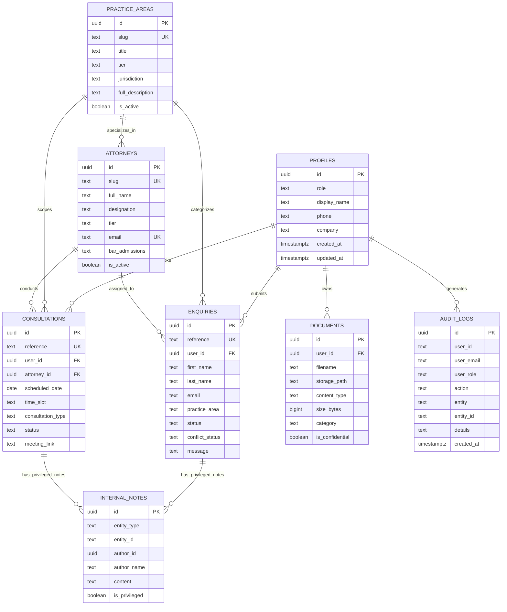

# Aurelius & Co. — Complete Database Schema & Relational Data Model

## 1. Overview
The **Aurelius & Co. Legal Technology Platform** database is architected on **PostgreSQL 15** via Supabase. It implements strict data integrity, foreign key relational constraints, check constraints, composite unique indexes, triggers for automatic timestamp updates and profile creation, and Row Level Security (RLS) policies enforcing zero-trust multi-tenancy.

---

## 2. Relational Entity-Relationship Model



---

## 3. Table Catalog & Specifications

### 3.1. `profiles`
User profiles extending Supabase `auth.users`. Automatically populated on sign-up via PostgreSQL trigger `on_auth_user_created`.

| Column | Data Type | Constraints | Description |
|---|---|---|---|
| `id` | `uuid` | PK, references `auth.users(id)` ON DELETE CASCADE | Unique user identifier |
| `role` | `text` | DEFAULT `'client'`, CHECK (`role IN ('super_admin', 'admin', 'attorney', 'client')`) | Role-based authorization tier |
| `display_name` | `text` | NULLABLE | Full name or executive title |
| `phone` | `text` | NULLABLE | Verified contact telephone |
| `company` | `text` | NULLABLE | Corporate or institutional affiliation |
| `avatar_url` | `text` | NULLABLE | Profile avatar image link |
| `created_at` | `timestamptz` | DEFAULT `NOW()` | Registration timestamp |
| `updated_at` | `timestamptz` | DEFAULT `NOW()` | Profile modification timestamp |

### 3.2. `practice_areas`
Registry of firm legal disciplines, tiers, and statutory practice areas.

| Column | Data Type | Constraints | Description |
|---|---|---|---|
| `id` | `uuid` | PK, DEFAULT `gen_random_uuid()` | Practice area unique ID |
| `slug` | `text` | UNIQUE, NOT NULL | URL-safe identifier |
| `title` | `text` | NOT NULL | Official legal practice title |
| `short_description` | `text` | NOT NULL | Editorial summary |
| `full_description` | `text` | NOT NULL | Detailed statutory scope |
| `tier` | `text` | DEFAULT `'Tier 1'`, NOT NULL | Legal 500 / Chambers ranking |
| `jurisdiction` | `text` | DEFAULT `'Global'` | Primary jurisdiction scope |
| `is_active` | `boolean` | DEFAULT `true` | Active display status |

### 3.3. `attorneys`
Partner, KC, and Senior Associate profiles with bar admissions and credentials.

| Column | Data Type | Constraints | Description |
|---|---|---|---|
| `id` | `uuid` | PK, DEFAULT `gen_random_uuid()` | Attorney unique ID |
| `slug` | `text` | UNIQUE, NOT NULL | URL-safe slug |
| `full_name` | `text` | NOT NULL | Full professional name |
| `designation` | `text` | NOT NULL | Partner / Senior Counsel designation |
| `tier` | `text` | DEFAULT `'Senior Partner'` | Seniority ranking |
| `email` | `text` | UNIQUE, NOT NULL | Direct firm email address |
| `phone` | `text` | NULLABLE | Chamber direct telephone line |
| `bio` | `text` | NOT NULL | Professional legal biography |
| `bar_admissions` | `text` | NOT NULL | Jurisdictions admitted to practice |
| `languages` | `text[]` | DEFAULT `ARRAY['English']` | Working languages |
| `is_active` | `boolean` | DEFAULT `true` | Active roster status |

### 3.4. `enquiries`
Public intake submissions and matter referrals.

| Column | Data Type | Constraints | Description |
|---|---|---|---|
| `id` | `uuid` | PK, DEFAULT `gen_random_uuid()` | Primary record key |
| `reference` | `text` | UNIQUE, NOT NULL | Matter tracking ref (`AUR-YYYYMMDD-XXXXXX`) |
| `user_id` | `uuid` | NULLABLE, FK `profiles(id)` | Registered user account if logged in |
| `first_name` | `text` | NOT NULL | Client given name |
| `last_name` | `text` | NOT NULL | Client surname |
| `email` | `text` | NOT NULL | Primary contact email |
| `phone` | `text` | NULLABLE | Contact phone |
| `preferred_contact_method` | `text` | DEFAULT `'email'` | Contact preference |
| `practice_area` | `text` | NOT NULL | Legal discipline |
| `message` | `text` | NOT NULL | Matter factual summary |
| `status` | `text` | DEFAULT `'new'`, CHECK (`status IN ('new', 'under_review', 'conflict_check', 'consultation_scheduled', 'matter_opened', 'declined', 'resolved')`) | Matter intake lifecycle stage |
| `conflict_status` | `text` | DEFAULT `'pending'`, CHECK (`conflict_status IN ('pending', 'cleared', 'flagged')`) | Ethical conflict screening state |
| `assigned_attorney_id` | `text` | NULLABLE | Assigned counsel ID |
| `created_at` | `timestamptz` | DEFAULT `NOW()` | Submission timestamp |

### 3.5. `consultations`
Scheduled legal consultations, calendar slots, and video chamber sessions.

| Column | Data Type | Constraints | Description |
|---|---|---|---|
| `id` | `uuid` | PK, DEFAULT `gen_random_uuid()` | Consultation unique ID |
| `reference` | `text` | UNIQUE, NOT NULL | Consultation ref (`CON-YYYYMMDD-XXXXXX`) |
| `user_id` | `uuid` | NULLABLE, FK `profiles(id)` | Client account ID |
| `client_name` | `text` | NOT NULL | Full client name |
| `client_email` | `text` | NOT NULL | Client email address |
| `attorney_id` | `text` | NULLABLE | Assigned attorney |
| `practice_area` | `text` | NOT NULL | Practice area identifier |
| `consultation_type` | `text` | DEFAULT `'online'`, CHECK (`consultation_type IN ('online', 'in_person', 'phone')`) | Mode of delivery |
| `scheduled_date` | `date` | NOT NULL | Scheduled calendar date |
| `time_slot` | `text` | NOT NULL | Hourly slot (`10:00 AM - 11:00 AM`) |
| `timezone` | `text` | DEFAULT `'GMT (UTC+0)'` | Consultation timezone |
| `meeting_link` | `text` | NULLABLE | Encrypted chamber video room URL |
| `status` | `text` | DEFAULT `'pending'`, CHECK (`status IN ('pending', 'confirmed', 'completed', 'cancelled', 'rescheduled')`) | Appointment lifecycle state |

**Concurrency Guarantee Index:**
```sql
CREATE UNIQUE INDEX idx_consultations_unique_booking
ON public.consultations (attorney_id, scheduled_date, time_slot)
WHERE status IN ('confirmed', 'pending');
```

### 3.6. `internal_notes`
Privileged attorney-client work product and internal counsel notes. Strictly inaccessible to clients.

| Column | Data Type | Constraints | Description |
|---|---|---|---|
| `id` | `uuid` | PK, DEFAULT `gen_random_uuid()` | Note ID |
| `entity_type` | `text` | NOT NULL, CHECK (`entity_type IN ('enquiry', 'consultation', 'client')`) | Target entity type |
| `entity_id` | `text` | NOT NULL | Target entity ID |
| `author_id` | `text` | NULLABLE | Author attorney / admin ID |
| `author_name` | `text` | NOT NULL | Author attorney name |
| `content` | `text` | NOT NULL | Legal work product notes |
| `is_privileged` | `boolean` | DEFAULT `true` | Legal privilege protection flag |
| `created_at` | `timestamptz` | DEFAULT `NOW()` | Timestamp |

### 3.7. `documents`
Client matter vault records, agreements, evidence, and filings.

| Column | Data Type | Constraints | Description |
|---|---|---|---|
| `id` | `uuid` | PK, DEFAULT `gen_random_uuid()` | Document ID |
| `user_id` | `uuid` | NULLABLE, FK `profiles(id)` | Client owner |
| `filename` | `text` | NOT NULL | File name |
| `storage_path` | `text` | NOT NULL | Encrypted storage path in Supabase Storage |
| `content_type` | `text` | DEFAULT `'application/pdf'` | MIME type |
| `size_bytes` | `bigint` | DEFAULT 0 | File size in bytes |
| `category` | `text` | DEFAULT `'other'` | Agreement, pleading, evidence, advice |
| `is_confidential` | `boolean` | DEFAULT `true` | Confidentiality flag |
| `uploaded_by_name` | `text` | NOT NULL | Uploader identity |

### 3.8. `audit_logs`
Immutable forensic audit trail for regulatory compliance.

| Column | Data Type | Constraints | Description |
|---|---|---|---|
| `id` | `uuid` | PK, DEFAULT `gen_random_uuid()` | Audit event ID |
| `user_id` | `text` | NOT NULL | Actor user ID or IP |
| `user_email` | `text` | NOT NULL | Actor email |
| `user_role` | `text` | NOT NULL | Actor role at time of action |
| `action` | `text` | NOT NULL | Action opcode (`SUBMIT_ENQUIRY`, `UPDATE_STATUS`, etc.) |
| `entity` | `text` | NOT NULL | Target table or subsystem |
| `entity_id` | `text` | NULLABLE | Target record ID |
| `details` | `text` | NULLABLE | Action details |
| `ip_address` | `text` | NULLABLE | Remote IPv4/IPv6 address |
| `created_at` | `timestamptz` | DEFAULT `NOW()` | Timestamp |

---

## 4. Row Level Security (RLS) Policy Specifications

1. **`enquiries`**:
   - `SELECT`: Clients can read only their own enquiries (`auth.uid() = user_id`). Counsel and Admins can view all enquiries (`role IN ('attorney', 'admin', 'super_admin')`).
   - `INSERT`: Public (anonymous or authenticated) can insert new enquiries.
   - `UPDATE`: Counsel and Admins only.

2. **`consultations`**:
   - `SELECT`: Clients view only their own consultations (`auth.uid() = user_id`). Counsel and Admins view all.
   - `INSERT`: Authenticated clients and public guests can book appointments.
   - `UPDATE`: Counsel and Admins only.

3. **`internal_notes` (Privileged Secrecy)**:
   - `SELECT`: Restricted exclusively to authenticated users whose profile role is `'attorney'`, `'admin'`, or `'super_admin'`. NEVER accessible to clients or anonymous callers.
   - `INSERT`: Restricted exclusively to counsel and administrators.

4. **`documents`**:
   - `SELECT`: Clients can only access documents where `user_id = auth.uid()`. Counsel and Admins can access all client documents.
   - `INSERT`: Authenticated users can upload to their own partition.

5. **`audit_logs`**:
   - `SELECT`: Strictly restricted to `'admin'` and `'super_admin'`.
   - `INSERT`: Permitted via server-side service role.
