# AURELIUS & CO. — IMPLEMENTATION ROADMAP & EXECUTION PLAN
**Target Milestone:** Production-Grade Enterprise Release  
**Execution Sequence:** Strict Dependency Order  

---

## Phase Execution Sequence

```mermaid
flowchart LR
    P0[Phase 0: Architecture & Audit] --> P1[Phase 1: Database Persistence Layer]
    P1 --> P2[Phase 2: Auth & Session Management]
    P2 --> P3[Phase 3: Core Business Logic & Isolation]
    P3 --> P4[Phase 4: Portal & Dashboard Hardening]
    P4 --> P5[Phase 5: Security Headers & Rate Limits]
    P5 --> P6[Phase 6: Testing & E2E Verification]
    P6 --> P7[Phase 7: Production Release & Runbook]
```

---

## Detailed Implementation Tasks

### Sprint 1: Persistent Database Service Layer (`lib/services/`)
- [x] Audit database entities, triggers, and Supabase migrations.
- [ ] Implement `lib/services/supabaseService.ts`:
  - `createEnquiry(payload)` -> writes to Supabase `enquiries` table with fallback.
  - `getEnquiries(filter)` -> queries Supabase `enquiries` table with fallback.
  - `bookConsultation(payload)` -> checks conflict and overlapping slots, writes to Supabase `consultations`.
  - `getConsultations(filter)` -> queries Supabase `consultations`.
  - `updateConsultationStatus(id, status, actor)` -> updates status and writes to `audit_logs`.
  - `addInternalNote(payload)` -> inserts into `internal_notes` table.
  - `getInternalNotes(entityType, entityId)` -> queries privileged `internal_notes`.
  - `logAudit(payload)` -> appends to `audit_logs`.
- [ ] Connect all `/api/*` endpoints to use `supabaseService`.

### Sprint 2: Authentication, Session Management & RBAC
- [ ] Configure Supabase Auth helper utilities in `lib/auth.ts`:
  - Verify JWT tokens in API route handlers (`verifyAuthToken`).
  - Extract user identity and role (`getUserFromToken`).
- [ ] Enhance Client Portal (`app/portal/page.tsx`):
  - Support real Supabase Auth login (`signInWithPassword`) and registration (`signUp`).
  - Load only the logged-in client's genuine inquiries, scheduled consultations, and uploaded documents.
  - Provide a clean demonstration switcher for evaluation purposes while keeping the real auth engine active.
- [ ] Enhance Attorney Workspace (`app/attorney/page.tsx`):
  - Role verification (must be `attorney`, `admin`, or `super_admin`).
  - Display assigned consultations and real-time status transitions.
- [ ] Enhance Admin Console (`app/admin/page.tsx`):
  - Enforce `admin` / `super_admin` role verification before granting workspace access.

### Sprint 3: Document Vault & Storage Integration
- [ ] Implement `/api/client/documents/route.ts`:
  - `POST`: Handle file metadata insertion and signed upload URL generation.
  - `GET`: Retrieve user's authorized documents and generate 15-minute signed download URLs.
  - Enforce file size (max 10MB) and allowed MIME types (PDF, Word, Images).
- [ ] Connect Client Portal document vault to live Supabase Storage bucket `client-documents`.

### Sprint 4: Security Headers & Rate Limiting
- [ ] Configure comprehensive HTTP security headers in `next.config.js`:
  - `Content-Security-Policy`
  - `Strict-Transport-Security` (HSTS: 2 years, preload)
  - `X-Frame-Options: DENY`
  - `X-Content-Type-Options: nosniff`
  - `Referrer-Policy: strict-origin-when-cross-origin`
  - `Permissions-Policy` (camera=(), microphone=(), geolocation=())
- [ ] Implement in-memory sliding-window rate limiter middleware for `/api/enquiries` and `/api/consultations`.

### Sprint 5: Testing, Browser Verification & Release
- [ ] Write integration and concurrency tests:
  - Test double-booking race condition.
  - Test client isolation (Client A cannot access Client B's documents).
  - Test internal note privacy (notes cannot be accessed by clients).
- [ ] Run test suite with Vitest and verify 100% pass rate.
- [ ] Commit, push to GitHub, and deploy to Vercel production.
- [ ] Verify production URL with browser subagent.
- [ ] Author final release and operational documentation.
