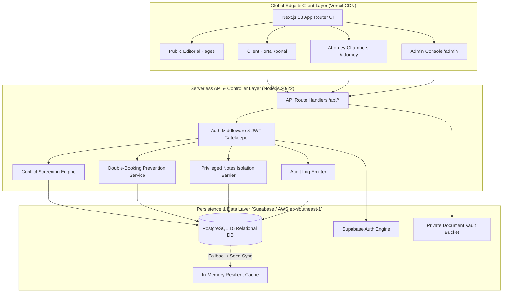

# AURELIUS & CO. — SYSTEM ARCHITECTURE SPECIFICATION
**Document Version:** 1.0.0  
**Status:** Approved Technical Architecture  

---

## 1. Architectural Overview

The **Aurelius & Co. Legal Platform** is designed as a hybrid enterprise architecture that delivers sub-100ms static edge performance for public prospective clients while providing strict relational integrity, zero-conflict ethical safeguards, and Row-Level Security (RLS) for confidential legal deliberations.



---

## 2. Core Architectural Layers

### A. Presentation & Client Layer (Next.js 13 App Router)
- **Framework:** Next.js 13.5.1 with Server Components for SEO and Client Components (`'use client'`) for interactive legal tools.
- **Styling Architecture:** Tailwind CSS with semantic legal tokens (`--navy`, `--gold`, `--ivory`, `--line-gold`).
- **State Management:** Reactive React hooks with optimistic UI updates and real-time backend synchronization.
- **Sensory & Telemetry:** Web Audio API haptic tone feedback, scroll progress telemetry, and responsive floating HUD.

### B. Controller & Business Logic Layer
- **Route Handlers:** Next.js 13 App Router `/api/*` handlers with standardized JSON responses:
  ```typescript
  // Standard Success Contract
  { ok: true, data: T, message?: string }
  
  // Standard Error Contract
  { error: string, code?: string, details?: any }
  ```
- **Validation Engine:** Strict server-side type and regex sanitation enforcing name lengths, email syntaxes, and date formats before database interaction.
- **Service Layer (`lib/services/`):** Clean separation between HTTP route handlers and database mutations.

### C. Authentication & Access Control Layer (RBAC)
- **Identity Provider:** Supabase Auth with secure JWT tokens.
- **Role Hierarchy:**
  - `super_admin`: Total system authority, audit inspection, and attorney credential certification.
  - `admin`: Operational practice management, conflict review, and consultation oversight.
  - `attorney`: Designated counsel access to assigned matters, consultation video rooms, and privileged internal notes.
  - `client`: Individual matter tracking, personal consultation history, and encrypted document access.
  - `anonymous`: Public editorial reading and non-confidential intake submission.

### D. Persistence & Storage Layer
- **Primary Database:** Managed Supabase PostgreSQL with 25 normalized relational entities.
- **Row-Level Security (RLS):** Declarative SQL policies enforcing tenant isolation directly at the database engine.
- **Object Storage:** Private Supabase Storage bucket (`client-documents`) served via short-lived signed URLs (15-minute expiration), strictly forbidding direct public bucket reads.
- **Resilient Memory Cache:** In-memory relational store operating as a zero-latency fallback and test runner substrate.
